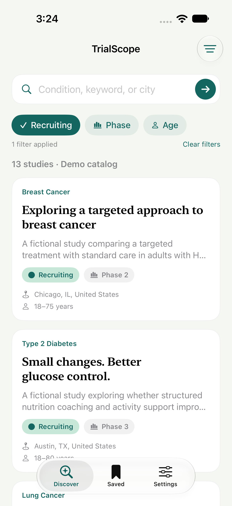

# TrialScope

An iOS app for finding clinical studies, saving studies for later, and keeping notes. Built with Swift 6, SwiftUI, and SwiftData.

The app calls the Clinical-Trial-SearchEngine backend through a configurable API URL. An explicit mock mode provides 18 fictional studies for offline demos and tests. Cloud sync is planned. Search results do not establish medical eligibility.

   

[Full screenshot gallery](docs/screenshots/README.md)

## Features

- Search by condition, keyword, or city.
- Filter by recruitment status, study phase, and age with one-tap chips.
- Browse paginated results and study criteria.
- Save studies and notes locally for offline access.
- Share study details using the native share sheet.
- Try empty results, delayed responses, and failure recovery with the mock service.

In mock mode, Settings includes switches for simulated failures and slow responses. These reset on launch; saved studies and notes persist.

## Getting started

Requires Xcode 16 or later and an installed iOS simulator runtime. The deployment target is iOS 17. The latest validation used Xcode 27.0 and an iPhone 18 Pro simulator running iOS 27.0.

1. Open `TrialScope.xcodeproj`.
2. Select the **TrialScope** scheme and an iPhone simulator.
3. Set `API_BASE_URL` in **Scheme → Run → Arguments → Environment Variables** to your server URL (for a local simulator, `http://localhost:8000`).
4. Run with **⌘R**.

For an offline demo, set `TRIALSCOPE_USE_MOCKS=1`. For a terminal launch using `.env`, run `./scripts/run-simulator.sh`. See [API setup and contract](docs/API.md).

For a physical device, select your signing team in Signing & Capabilities and use a unique bundle identifier.

## Project structure

```text
App/                         App entry point, assets, privacy manifest
Packages/TrialKit/
  Sources/TrialCore/          Models, search service, state, persistence
  Sources/TrialUI/            SwiftUI screens and UIKit sharing
  Tests/TrialCoreTests/       Search, concurrency, and persistence tests
TrialScopeUITests/            XCTest UI flows
scripts/                     Project generation and screenshot export
docs/                        Architecture, validation, and screenshots
```

`TrialService` separates the UI from the data source. The HTTP implementation calls `/rank` and `/trials/{nct_id}`; tests inject mocks. Ranked results are limited to the server’s top 20. `SearchModel` cancels superseded requests and rejects stale responses. SwiftData stores complete study snapshots and notes so saved details remain available offline. UIKit provides the share sheet.

See [architecture](docs/Architecture.md) for the state and persistence decisions. The Xcode project can be regenerated with `python3 scripts/generate_project.py`; keep the generator in sync with project-setting changes.

## Tests

Run the package tests with full Xcode selected:

```sh
swift test --package-path Packages/TrialKit
```

Run the UI suite, replacing the simulator name if needed:

```sh
xcodebuild test -project TrialScope.xcodeproj -scheme TrialScope \
  -destination 'platform=iOS Simulator,name=iPhone 18 Pro' \
  CODE_SIGNING_ALLOWED=NO
```

The latest run passed **19 logic, API contract, and persistence tests** and **4 UI tests** (iPhone 18 Pro simulator, iOS 27.0, mock mode). UI tests use an in-memory store; persistence tests use isolated stores. Live-backend testing is still pending. Test results and remaining manual checks are in [QA](docs/QA.md).

[GitHub Actions](.github/workflows/ios.yml) runs package and simulator tests. UI screenshots can be exported using [these instructions](docs/screenshots/README.md).

## Next steps

- Run against the full local backend stack and verify deployment-specific data and ranking behavior.
- Verify physical-device, iPad, VoiceOver, and larger text layouts.
- Implement and test [CloudKit sync](docs/CloudKit.md). The default app uses local storage only.
