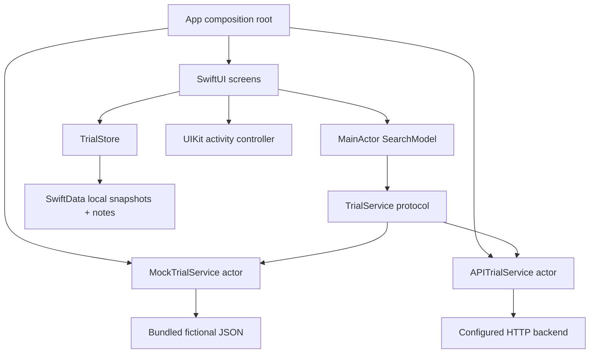

# Architecture and decisions

## State and concurrency

`SearchModel` is observable and MainActor-isolated. The service is Sendable and the mock implementation is an actor. Each fresh search cancels its preceding task and advances a generation ID. A response must match that ID and must not be cancelled to update the UI. This protects against services that ignore cancellation as well as cancellation-aware ones.

New searches clear prior results, making query/result association explicit. A page failure keeps the current results and the next offset; retry loads that page. Repeated load-more taps are gated. Explicit submit avoids sending a request for every keystroke and avoids accidental early searches while typing a condition.

## Search semantics

Search folds case/diacritics, requires every token to match the searchable fields, and ranks title/condition matches higher. Ties use stable fixture IDs. Recruitment, phase, and age filters compose with AND. An omitted maximum age is unbounded. This deterministic algorithm exists for exercising client behavior, not for validating the clinical-trial search engine's ranking quality.

## Persistence

`SavedTrial` stores a JSON snapshot, stable trial ID, save date, and notes. Keeping the complete snapshot supports offline detail views independently of the service. App writes save explicitly and report errors. Failed writes roll back. The note sheet edits a draft so Cancel does not write partial notes.

The local store prevents duplicate saves by querying the stable trial ID. We deliberately avoid a unique constraint for compatibility with a future CloudKit configuration. That is not a distributed uniqueness guarantee; see the CloudKit document. Invalid stored snapshots are handled in Saved rather than crashing the app. A startup storage failure does not silently delete or replace the persistent store.

## Integration boundary

`APITrialService` implements the same service boundary using URLSession. It posts searches to `/rank`, caches the returned top-20 window for local paging, and fetches full details from `/trials/{nct_id}`. Saved views read snapshots without networking. See [API configuration, DTO mapping, and limitations](API.md).

The app selects its service at startup. Normal runs require `API_BASE_URL`; explicit mock mode and UI tests use `MockTrialService`. Missing configuration or a server error never silently selects demo data.

## Frameworks

- SwiftUI handles navigation, forms, sheets, and adaptive layouts.
- UIKit provides sharing through `UIViewControllerRepresentable`.
- SwiftData stores offline snapshots and notes.
- Swift Testing covers shared logic; XCTest covers UI flows.
- CloudKit configuration is optional and requires further implementation and testing.

Mock mode makes no network requests and includes no analytics. Searches are not persisted, and shared study details exclude private notes.
