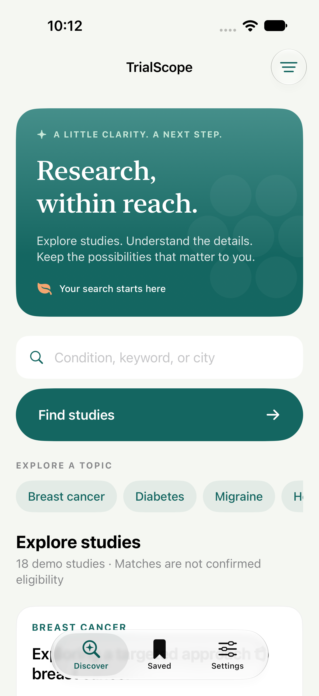
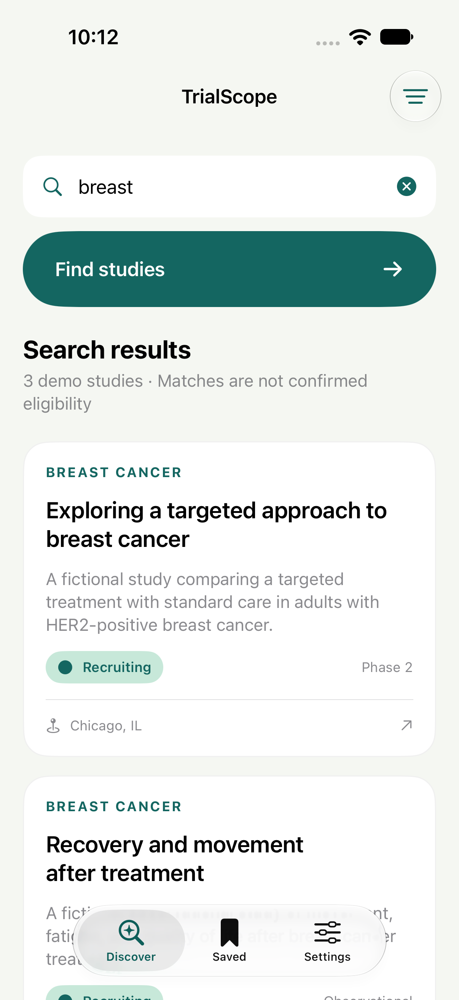
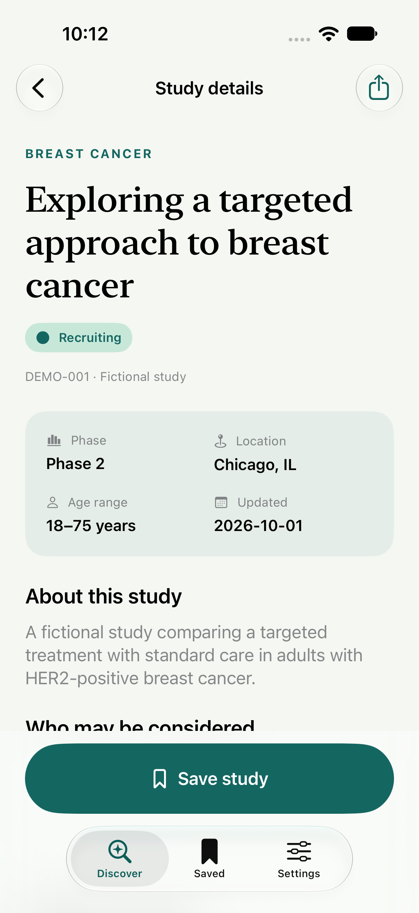
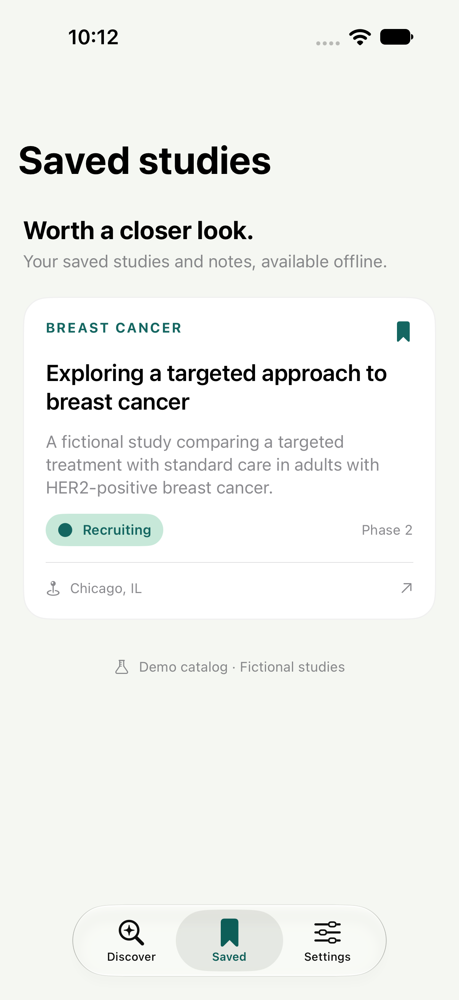
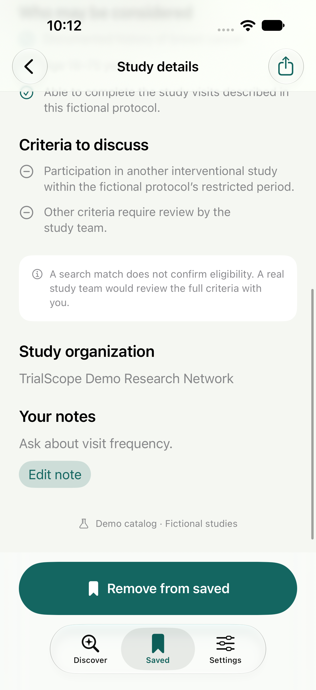
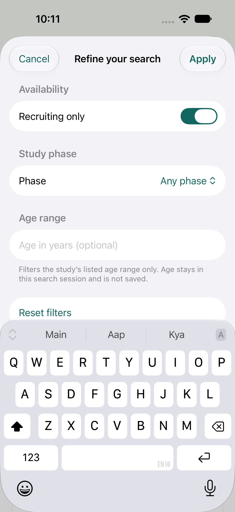
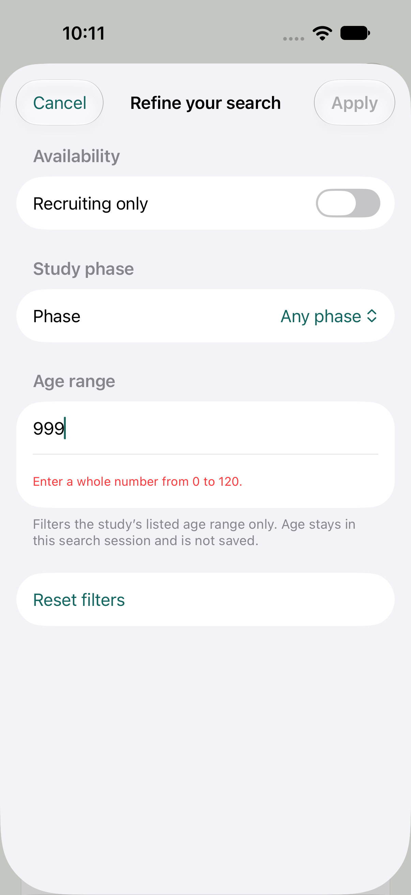
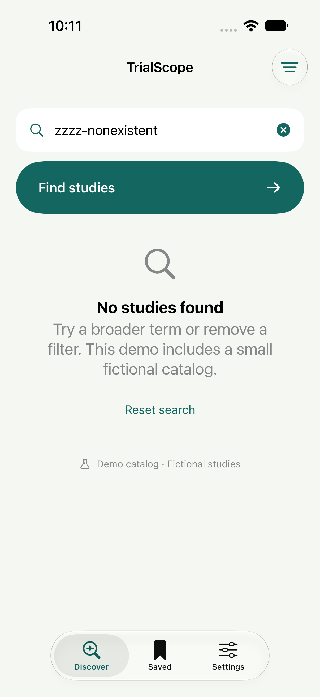
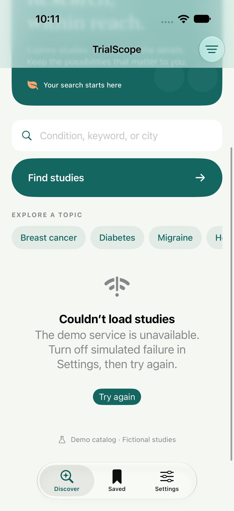

# Simulator screenshots

Original, unmodified PNG attachments captured by the XCTest UI suite on an iPhone 18 Pro simulator running iOS 27.0. All studies and notes shown are fictional demo data.

`manifest.json` records each image's originating test, device, and timestamp. These are screenshots of exercised app states, not a substitute for the test results in `../test-results/` and the validation record in `../QA.md`.

## Main experience

| Discover | Results | Details |
| --- | --- | --- |
|  |  |  |

| Saved studies | Notes | Recruiting filter |
| --- | --- | --- |
|  |  |  |

## Tested edge cases

| Invalid age | Empty results | Service failure |
| --- | --- | --- |
|  |  |  |

After disabling the simulated failure and retrying: [recovered results](10-recovered-results.png).

## Recreate

Run the UI suite with `-resultBundlePath /tmp/TrialScope-new.xcresult`, then:

```sh
xcrun xcresulttool export attachments \
  --path /tmp/TrialScope-new.xcresult --output-path /tmp/trialscope-attachments
python3 scripts/export_screenshots.py /tmp/trialscope-attachments
```

Run commands from the project root. The exporter only copies explicitly named PNG attachments; recordings, failure hierarchies, and host paths are not copied into this gallery.

For a GitHub README at the repository root:

```html


```
